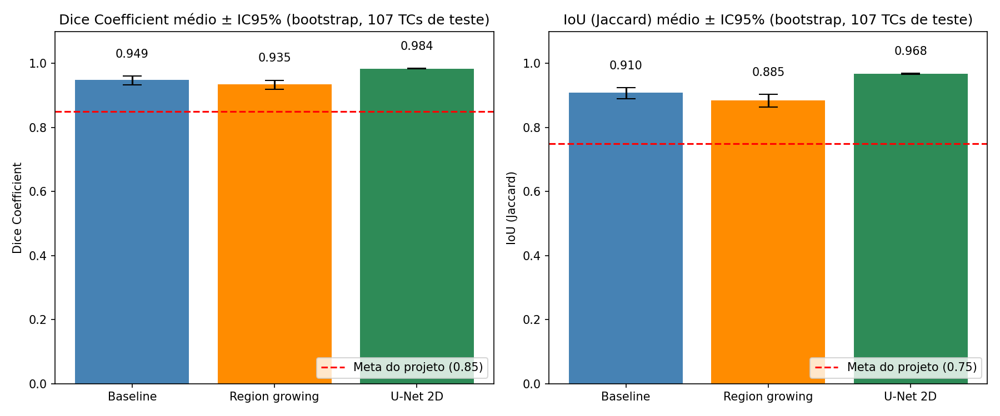
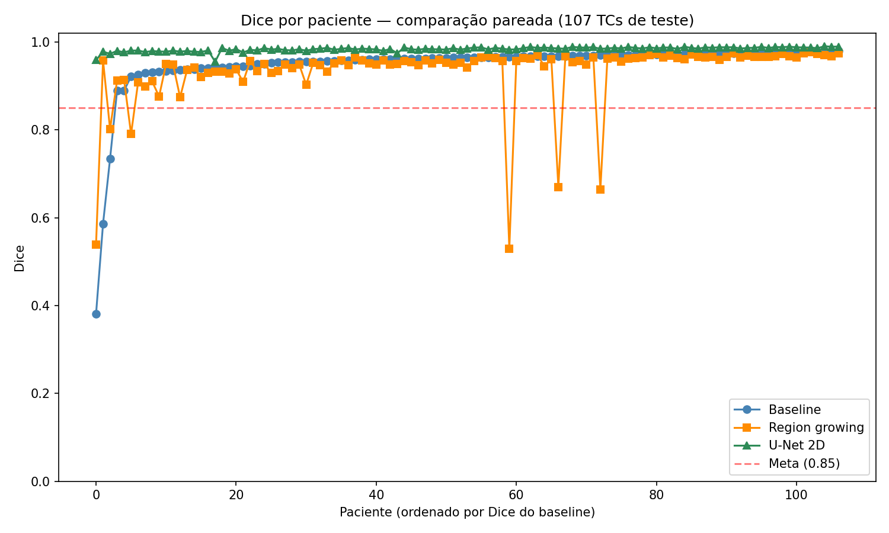

# Segmentação Automática do Parênquima Pulmonar em Tomografias Computadorizadas de Tórax: métodos clássicos baseados em Hounsfield contra uma U-Net 2D

**Grupo 02 — Projeto Integrador III**

[PREENCHER: integrantes, instituição, curso, professor, data]

> **Antes de entregar (apagar este quadro depois):**
> 1. Conferir no PDF cada referência marcada "conferir" em [`docs/referencias.md`](docs/referencias.md).
> 2. Confirmar que nenhum parâmetro dos métodos foi ajustado olhando os 107 exames do
>    teste oficial (seção 4.4).
> 3. Decidir se a seção 8 (detecção de nódulos) fica no relatório ou sai como anexo.
> 4. Remedir o tempo dos três métodos na mesma máquina, ou manter a ressalva da seção 5.5.
> 5. Reler o texto inteiro e ajustar ao estilo exigido pela disciplina.

---

## Resumo

A segmentação do parênquima pulmonar é o primeiro passo de qualquer análise automática de
tomografia (TC) de tórax, porque delimita a região onde depois se procuram nódulos. Este
trabalho compara três métodos no LUNA16:
- um **baseline** de limiar global em −600 HU com operações morfológicas;
- um **region growing** com sementes automáticas;
- uma **U-Net 2D** treinada.

A hipótese do trabalho é que os métodos clássicos baseados na escala de Hounsfield já
passam da meta do projeto (Dice ≥ 0,85) e que a U-Net os supera. Ela foi dividida em três
hipóteses testáveis, avaliadas com Wilcoxon unilateral pareado e correção de Holm.

O teste oficial tem **107 exames** que nunca foram usados no desenvolvimento dos métodos. A
divisão é 70/15/15 por paciente, sobre os 710 exames do LUNA16 que ficaram fora da primeira
fase. Os resultados, com IC95% por bootstrap, foram:
- **U-Net:** Dice médio 0,9838 [0,9827; 0,9847];
- **baseline:** 0,9492 [0,9336; 0,9604];
- **region growing:** 0,9353 [0,9201; 0,9479].

As três hipóteses tiveram estes resultados:
- **A meta foi atingida** pelos três métodos.
- **O region growing foi pior que o baseline** (−0,0139 [−0,0282; −0,0004]), o contrário do
  previsto. Ele perde sensibilidade porque a banda de crescimento é mais restritiva que o
  limiar global.
- **A U-Net superou os dois métodos clássicos nos 107 exames** (+0,0346 sobre o baseline).
  Ela nunca ficou abaixo de 0,955, enquanto o baseline chegou a 0,381.

Com duas sementes de treino, o Dice da U-Net varia só ±0,0004. A vantagem média é pequena
porque o baseline já resolve a maior parte do problema. A diferença aparece nos casos
difíceis e na borda do pulmão. Num conjunto anterior de 26 exames, a máscara do baseline
apagava 13 de 43 nódulos anotados (8 dos 9 colados na pleura), e a da U-Net apagava 3
(McNemar, p = 0,006).

O trabalho segue as cinco etapas do KDD, num único script reprodutível.

**Palavras-chave:** segmentação pulmonar; tomografia computadorizada; LUNA16; U-Net;
limiarização; crescimento de região.

## 1. Introdução

O câncer de pulmão é uma das principais causas de morte por câncer, e a detecção precoce de
nódulos em TC de tórax é o caminho para reduzir esse número. Sistemas de apoio ao
diagnóstico (CAD) dividem o problema em etapas, e a primeira é isolar o parênquima pulmonar
das estruturas vizinhas (parede torácica, mediastino, coração, vias aéreas e o ar fora do
corpo). Um erro nessa etapa contamina todas as seguintes. O pior caso é o de um nódulo que
a máscara deixa de fora: ele nunca chega ao detector (Armato e Sensakovic, 2004).

O LUNA16 (Setio et al., 2017) é a base padrão para esse problema. Ele reúne 888 TCs do
LIDC-IDRI (Armato et al., 2011), com nódulos anotados por radiologistas e uma máscara de
referência do pulmão para cada exame.

Há duas famílias de métodos de segmentação:
- **Métodos clássicos:** usam a física da TC. O pulmão aerado fica perto de −850 HU, muito
  abaixo dos tecidos moles, e isso permite segmentar por limiar e morfologia (Hu, Hoffman e
  Reinhardt, 2001) ou por crescimento de região (Adams e Bischof, 1994).
- **Métodos aprendidos:** a U-Net (Ronneberger, Fischer e Brox, 2015) aprende a forma do
  pulmão a partir de exemplos rotulados.

Hofmanninger et al. (2020) mostraram que, em segmentação de pulmão, a diversidade dos dados
de treino pesa mais que a arquitetura escolhida.

A pergunta deste trabalho é **quanto um método aprendido acrescenta a métodos clássicos bem
construídos, onde esse ganho aparece e a que custo**. A pergunta é prática: se o limiar já
resolve quase tudo, a contribuição relevante é mostrar em que casos ele falha e se a rede
corrige esses casos.

## 2. Hipótese

> **Hipótese geral:** a segmentação do parênquima pulmonar em TC do LUNA16 atinge
> sobreposição útil (Dice acima da meta do projeto) com métodos clássicos baseados na escala
> de Hounsfield, e um método aprendido (U-Net 2D) supera os métodos clássicos em
> sobreposição com a máscara de referência.

| | H0 (nula) | H1 (alternativa) |
|---|---|---|
| **H1** — meta | Dice médio ≤ meta | Dice médio > meta (0,85 para os clássicos, 0,75 para a U-Net) |
| **H2** — adaptativo × global | Dice do region growing ≤ Dice do baseline | Dice do region growing > Dice do baseline |
| **H3** — aprendido × clássico | Dice da U-Net ≤ Dice do clássico | Dice da U-Net > baseline (H3a) e > region growing (H3b) |

As metas vêm da pergunta SMART do projeto e do feedback do Checkpoint 1. A redação formal de
H0 e H1 foi feita depois dos primeiros resultados, no conjunto de 26 exames. Por isso, o
teste que vale como confirmação é o do conjunto de 107 exames, que não tinha sido usado.
Detalhes em [`docs/hipotese.md`](docs/hipotese.md).

## 3. Base de dados

### 3.1. Fonte e gabarito

- **Imagens:** LUNA16, em `.mhd`/`.raw`. Os organizadores já excluíram os exames com corte
  mais grosso que 3 mm.
- **Gabarito do pulmão:** `seg-lungs-LUNA16`. Os rótulos 3 e 4 são os pulmões, e a união dos
  dois é a referência. O rótulo 5 é a traqueia e fica de fora.
  - **Essa máscara foi gerada por algoritmo automático, não por radiologista.** O Dice deste
    trabalho mede a concordância com outro algoritmo, e não o acerto anatômico (seção 7).
- **Nódulos:** `annotations.csv`, com centro e diâmetro. São os nódulos de 3 mm ou mais
  aceitos por pelo menos 3 de 4 radiologistas.

### 3.2. Duas fases

| Fase | Exames | Divisão por paciente (semente 42) | Papel |
|---|---|---|---|
| 1 | 177 (subset0 + subset1) | 124 treino / 27 validação / **26 teste** (Teste A) | Desenvolvimento e diagnóstico de erros; histórico |
| 2 | 710 inéditos (888 − os 177 da fase 1 − 1 exame com geometria divergente) | 497 treino / 106 validação / **107 teste** | **Teste oficial** |

Na fase 1, nenhum exame foi excluído pelos critérios de inclusão: máscara presente e não
vazia, e espaçamento entre cortes de até 2,5 mm. Os 177 exames da fase 1 ficaram em
quarentena na fase 2: **nenhum deles está no treino nem no teste da fase 2.**

O sorteio, o treino da U-Net e o teste da fase 2 não aplicam o filtro de espaçamento.
Por isso o teste oficial tem 107 exames, e não os 99 que sobrariam depois do filtro.
Contagens completas em [`docs/base_oficial.md`](docs/base_oficial.md).

## 4. Metodologia (processo KDD)

O trabalho segue as cinco etapas do KDD (Fayyad, Piatetsky-Shapiro e Smyth, 1996). Elas
rodam em ordem num único comando, `python scripts/pipeline_kdd.py`, que salva a evidência
de cada etapa em `data/luna16/kdd/` ([`docs/kdd.md`](docs/kdd.md)).

### 4.1. Seleção

São lidos os cabeçalhos de todos os exames e aplicados os critérios de inclusão. Em
seguida, os exames são divididos por **paciente**, nunca por fatia, e o código confere que
treino, validação e teste não se sobrepõem.

### 4.2. Pré-processamento

1. **Limpeza de HU:** o valor de preenchimento fora do campo de visão do tomógrafo vira ar
   (−1000 HU), e os valores são recortados em [−1000, 400] HU.
2. **Ruído:** filtro Gaussiano 3D com σ = 0,5 voxel.

### 4.3. Transformação

- Os volumes são reamostrados para 1 mm isotrópico, porque o espaçamento entre cortes
  varia de 0,5 a 2,5 mm e as operações morfológicas 3D supõem voxels cúbicos.
- Para a U-Net, as fatias axiais são normalizadas para [−1, 1] e redimensionadas para
  128 × 128.

### 4.4. Mineração: os três métodos

**Baseline (limiar + morfologia)**, nesta ordem:
1. limiar em −600 HU;
2. remoção do ar de fundo fatia a fatia, usando o perímetro inteiro da fatia;
3. os dois maiores componentes conexos em 3D;
4. preenchimento de buracos, para incluir vasos e nódulos internos;
5. abertura morfológica com elemento esférico de raio 1 voxel.

A remoção do fundo é feita por fatia porque, em 3D, a traqueia pode ligar o pulmão ao ar
de fora do corpo.

**Region growing**: uma semente automática em cada pulmão, no ponto mais interior entre os
voxels abaixo de −750 HU (via transformada de distância). A região cresce para os vizinhos
dentro de ±200 HU do valor da semente, restrita à mesma região segura do baseline.

**U-Net 2D**: a `SmallUNet2D` tem 32 canais na base.
- **Treino:** perda BCE + Dice (Milletari, Navab e Ahmadi, 2016), Adam com taxa de
  aprendizado 10⁻³, lote de 16 e 25 épocas, sem aumento de dados. Os pesos usados são os da
  última época.
- **Fatias por exame:** até 20 com pulmão e até 6 sem pulmão.
- **Saída:** a máscara passa por uma limpeza de componentes conexos que mantém os
  componentes com pelo menos 15% do volume do maior. A limpeza existe porque a rede chegou
  a marcar o ar da mesa do tomógrafo como pulmão.
- **Duas redes:** a da fase 2 (oficial) foi treinada com os 497 exames de treino, com
  sementes 123 e 42. A da fase 1 foi treinada com 124 exames.

**Como os parâmetros foram escolhidos.** O limiar de −600 HU, o raio morfológico e a banda
de ±200 HU vêm da física da TC e da literatura, e foram ajustados na fase 1. Duas correções
(a semente abaixo de −750 HU e a limpeza relativa da U-Net) foram diagnosticadas olhando
exames do Teste A. Nenhum exame do teste oficial participou dessas decisões.
[CONFIRMAR COM O GRUPO]

### 4.5. Interpretação e avaliação

- **Métricas por exame (Dice 3D):** Dice e IoU são as primárias; sensibilidade, precisão e
  tempo por exame são as secundárias (Taha e Hanbury, 2015). A acurácia não é usada, porque
  o fundo domina o volume e ela seria enganosa.
- **Intervalos:** IC95% por bootstrap com 10.000 reamostras e semente 42 (Efron e
  Tibshirani, 1993).
- **Hipóteses:**
  - teste de Wilcoxon unilateral (Wilcoxon, 1945), pareado por exame, com correção de Holm
    (Holm, 1979) em cada família de testes e α = 0,05;
  - o Wilcoxon foi escolhido e não o teste t, porque há exames extremos e as diferenças não
    seguem uma distribuição normal.
- **Nódulos:** a comparação entre métodos usa o teste exato de McNemar (McNemar, 1947).

## 5. Resultados

### 5.1. Teste oficial (107 exames)

Fonte: `data/luna16/tabela_resultados_finais_novo.csv`. U-Net: semente 123.

| Método | Dice [IC95%] | IoU [IC95%] | Sensibilidade | Precisão | Pior exame | Exames < 0,85 |
|---|---|---|---|---|---|---|
| Baseline | 0,9492 [0,9336; 0,9604] | 0,9095 [0,8892; 0,9246] | 0,934 | 0,968 | 0,381 | 3 |
| Region growing | 0,9353 [0,9201; 0,9479] | 0,8855 [0,8645; 0,9034] | 0,901 | 0,981 | 0,530 | 6 |
| U-Net 2D | **0,9838** [0,9827; 0,9847] | **0,9681** [0,9660; 0,9698] | **0,983** | **0,985** | **0,955** | **0** |

### 5.2. Teste das hipóteses (107 exames)

Fonte: `data/luna16/kdd/etapa5_teste_hipoteses_novo.csv`.

| Hipótese | Efeito [IC95%] | p (Holm) | Decisão |
|---|---|---|---|
| H1 — Baseline > 0,85 | Dice 0,9492 [0,9336; 0,9604] | 4,0 × 10⁻¹⁶ | H0 rejeitada |
| H1 — Region growing > 0,85 | Dice 0,9353 [0,9201; 0,9479] | 1,1 × 10⁻¹⁴ | H0 rejeitada |
| H1 — U-Net > 0,75 | Dice 0,9838 [0,9827; 0,9847] | 4,1 × 10⁻¹⁹ | H0 rejeitada |
| H2 — Region growing > Baseline | −0,0139 [−0,0282; −0,0004] | 1,0 | H0 não rejeitada; efeito **oposto** ao previsto |
| H3a — U-Net > Baseline | +0,0346 [+0,0238; +0,0496] | 2,7 × 10⁻¹⁹ | H0 rejeitada |
| H3b — U-Net > Region growing | +0,0484 [+0,0362; +0,0631] | 2,7 × 10⁻¹⁹ | H0 rejeitada |

**Exame a exame:**
- a U-Net foi melhor que o baseline e que o region growing nos **107 de 107** exames;
- o region growing foi melhor que o baseline em só **15 de 107**.

### 5.3. Variação entre sementes de treino

O desvio-padrão entre exames não mede a estabilidade do treino. Para isso, a U-Net da fase 2
foi treinada duas vezes, com sementes diferentes (Dice 3D por exame):

| Conjunto | Semente 42 | Semente 123 |
|---|---|---|
| 99 exames em comum | 0,9841 | 0,9834 |
| Conjunto próprio de teste de cada rodada | 0,9840 (125 exames) | 0,9834 (107 exames) |

Média entre as sementes: **0,9837 ± 0,0004**. A diferença entre as duas rodadas é menor que
o IC95% de cada uma.

A semente 42 foi avaliada no teste da própria rodada, para não usar exames que possam ter
entrado no treino dela. Por isso, a comparação justa é a dos 99 exames em comum.

### 5.4. Histórico: Teste A (26 exames)

Na fase 1, a U-Net era a treinada com 124 exames, e as decisões das três hipóteses foram as
mesmas:

| Método | Dice [IC95%] | Pior exame |
|---|---|---|
| Baseline | 0,9555 [0,9416; 0,9663] | 0,847 |
| Region growing | 0,9354 [0,9006; 0,9582] | 0,594 |
| U-Net 2D (124 exames) | 0,9818 [0,9790; 0,9843] | 0,963 |

**Efeito das correções de 26/10 no Teste A:**
- **Region growing:** a semente passou a ser escolhida abaixo de −750 HU. O Dice médio foi
  de 0,9065 para 0,9354, e o exame que colapsava passou de 0,226 para 0,978.
- **U-Net:** a limpeza passou a ser relativa. O Dice médio foi de 0,9781 para 0,9818, com
  963 mL de falso positivo removidos e a sensibilidade igual.

### 5.5. A segmentação apaga nódulos? (Teste A)

O Dice do pulmão inteiro quase não sente um nódulo de 6 mm, mas um nódulo fora da máscara
nunca chega ao detector. Por isso, nos 18 exames do Teste A que têm nódulo, foi verificado
se cada um dos 43 nódulos anotados continua dentro da máscara de cada método.

Os critérios foram fixados antes de rodar:
- o nódulo é uma esfera com o diâmetro anotado;
- ele conta como mantido se pelo menos 50% da esfera está dentro da máscara;
- ele conta como colado na borda se a esfera, inflada em 2 mm, toca tecido acima de −300 HU
  fora da referência.

| Máscara | Mantidos (de 43) | Colados na borda mantidos (de 9) | Interiores mantidos (de 34) |
|---|---|---|---|
| Referência LUNA16 | 42 | 8 | 34 |
| Baseline | 30 | 1 | 29 |
| Region growing | 28 | 1 | 27 |
| U-Net 2D (124 exames) | 40 | 7 | 33 |

A U-Net mantém 11 nódulos que o baseline apaga, e o contrário acontece em 1 caso (McNemar
exato, p = 0,006). Fonte: `data/luna16/nodulos_apagados_teste.csv`. Esta análise ainda não
foi repetida no teste oficial.

### 5.6. Tempo de processamento

| Conjunto | Baseline | Region growing | U-Net |
|---|---|---|---|
| Teste A (mesma máquina, CPU, U-Net de 124 exames) | 16,0 s | 19,4 s | 62,1 s |
| Teste oficial (outra máquina, U-Net nova) | 6,3 s | 8,0 s | 7,1 s |

As duas linhas não se comparam entre si, porque são máquinas e redes diferentes. A máquina
do teste oficial não está registrada. [REMEDIR ou manter esta ressalva]

## 6. Discussão

### 6.1. A física da TC já resolve a maior parte do problema

O limiar global de −600 HU, sem nenhum aprendizado, passa da meta com folga: o limite
inferior do IC95% é 0,934. O parênquima aerado fica tão separado em HU dos tecidos vizinhos
que um limiar bem construído captura quase todo o pulmão. Esse resultado é a primeira parte
da hipótese, e é também o motivo de a vantagem média da U-Net ser pequena (+0,035 de Dice).

### 6.2. Onde a U-Net ganha: nos casos difíceis, e não na média

A média esconde a diferença que importa. A U-Net vence nos 107 exames, mas o ganho se
concentra onde os métodos clássicos falham:
- **No pior exame do baseline**, o Dice é 0,381, com sensibilidade de 0,29 e precisão de
  0,54. A U-Net tem 0,959 no mesmo exame.
- **Nos piores exames**, os clássicos ficam abaixo da meta: o baseline em 3 exames e o
  region growing em 6. A U-Net nunca fica abaixo de 0,955.
- **No Teste A**, o ganho da U-Net no quartil mais difícil foi de +0,054, contra +0,001 no
  mais fácil (`docs/piores_casos/`). Essa análise da Sprint 4 é de antes das correções de
  26/10, e ainda não foi refeita no teste oficial.

O mecanismo do erro clássico é a **omissão**. O parênquima denso, o volume parcial nas
bordas e os nódulos colados na pleura ficam acima de −600 HU e são classificados como "não
pulmão". O preenchimento de buracos não os recupera, porque um nódulo justapleural não é um
buraco fechado: ele está aberto para a parede. A U-Net aprendeu com uma referência que
inclui essas regiões.

A consequência para a etapa seguinte do pipeline é direta: no Teste A, o baseline apaga 13
de 43 nódulos e a U-Net apaga 3. **A métrica do projeto (Dice) subestima a vantagem da
U-Net justamente no que importa para detectar nódulos.**

### 6.3. Comparação com a literatura e contribuição do trabalho

Hofmanninger et al. (2020) relatam Dice de 0,97 a 0,98 para U-Net em segmentação de pulmão,
e a U-Net deste trabalho (0,984) está nessa faixa. O mesmo trabalho conclui que a
diversidade dos dados pesa mais que a arquitetura. Aqui, a rede treinada com 497 exames
manteve a média (0,984) num conjunto quatro vezes maior e inédito. A rede de 124 exames
tinha 0,982 no Teste A. Os dois conjuntos são diferentes, então isso não mede o efeito do
tamanho do treino.

A contribuição deste trabalho, portanto, não é "a rede ganha". São três coisas:
1. **Quantificar quanto a rede ganha:** +0,035 de Dice, com IC, em 107 exames inéditos.
2. **Mostrar onde ela ganha:** nos casos difíceis e na borda do pulmão, com efeito direto
   sobre os nódulos.
3. **Mostrar o que custa:** treino, dados rotulados e hardware.

E há um resultado negativo legítimo: o método "adaptativo" não foi melhor que o global.

### 6.4. Por que o region growing perdeu (H2)

A semente fica no parênquima aerado, abaixo de −750 HU e tipicamente entre −850 e −970 HU.
Com a banda de ±200 HU, o crescimento para por volta de −650 a −770 HU, um teto **mais
restritivo** que o limiar global de −600 HU. O parênquima mais denso fica de fora.

O resultado aparece nas métricas: a sensibilidade do region growing é menor (0,901 contra
0,934), e a precisão é maior (0,981 contra 0,968). Ou seja, ele deixa pulmão de fora, mas
não marca coisa errada. Ser adaptativo não significou ser melhor neste problema.

### 6.5. A análise de falhas encontrou erros de implementação, e não só limites dos métodos

Os piores resultados da fase 1 vinham de três defeitos de código, e não de casos clínicos
atípicos:
1. A remoção do ar de fundo olhava só os 4 cantos da fatia, e o ar sob a mesa do tomógrafo
   escapava.
2. A semente do region growing podia cair na franja dos vasos.
3. A limpeza da U-Net guardava "os 2 maiores componentes", e os dois pulmões saem unidos
   pela carina.

Cada um foi diagnosticado, corrigido com justificativa física e documentado com o
diagnóstico inicial errado. A lição metodológica é que um erro de pipeline pode imitar uma
limitação do método, e por isso é preciso investigar antes de concluir.

## 7. Limitações

- **O gabarito é gerado por algoritmo.** Em 2 dos 6 exames de maior discordância da U-Net,
  a máscara do LUNA16 marca gás do estômago ou do intestino como pulmão, e a rede está certa
  ([`docs/discordancia_unet/`](docs/discordancia_unet/)). Parte do que o Dice conta como erro
  é erro da referência.
- **Viés de volume:** a inspeção de 12 exames mostrou que a predição do baseline fica, em
  média, 5% abaixo do volume de referência (até 22%), e que a traqueia entra na predição em
  todos os 12.
- **Uma única fonte de dados:** todos os exames vêm do LIDC-IDRI. A generalização para
  outros tomógrafos e hospitais não foi testada.
- **Hipóteses formalizadas depois dos primeiros resultados:** o teste de 107 exames inéditos
  reduz esse problema, mas o trabalho não foi pré-registrado.
- **Nódulos apagados e piores casos** foram analisados no Teste A (26 exames), e não no teste
  oficial.
- **Tempo:** os tempos do teste oficial foram medidos numa máquina não registrada (seção
  5.6).
- **Sementes:** só duas sementes de treino.
- **Não é um dispositivo médico.** Nenhum resultado deste trabalho deve ser usado em decisão
  clínica. O uso clínico exigiria registro na ANVISA (RDC 657/2022), validação prospectiva e
  multicêntrica e monitoramento depois da implantação.

## 8. Extensão exploratória: detecção de nódulos

Esta parte **não faz parte do escopo formal** da entrega e usa a divisão antiga, de antes
do feedback (60/20/20).

Dentro do pulmão segmentado pelo baseline, os candidatos a nódulo foram detectados por
Laplaciano do Gaussiano (`skimage.feature.blob_log`), na faixa de densidade de tecido mole.
A avaliação seguiu o padrão FROC do LUNA16: um candidato acerta se o centro cai dentro do
raio anotado.

| Etapa | Exames | Sensibilidade | Candidatos por exame |
|---|---|---|---|
| Só detecção (Sprint 7) | 20 | 75,9% (63 de 83 nódulos) | ≈ 5.864 |
| Com filtro por Random Forest (Sprint 8) | 15 | de 74% (23 de 31) para 48% (15 de 31) | de ≈ 5.545 para ≈ 855 |

**O que isso mostra:**
- A detecção clássica encontra três quartos dos nódulos, mas com milhares de falsos
  positivos por exame.
- Um classificador simples corta 85% dos candidatos, mas perde sensibilidade.
- É a estrutura conhecida do problema, que o próprio LUNA16 divide em geração de candidatos e
  redução de falsos positivos (Setio et al., 2017).
- O próximo passo natural seria repetir esta etapa sobre a máscara da U-Net, que preserva
  mais nódulos de borda (seção 5.5).

## 9. Conclusão

As três hipóteses foram testadas num conjunto de 107 exames que não participou do
desenvolvimento:
1. **Os métodos clássicos baseados em Hounsfield bastam para a média.** O baseline passa da
   meta com folga (Dice 0,949).
2. **O método adaptativo não foi melhor que o global.**
3. **A U-Net supera os dois em todos os exames** (Dice 0,984). Ela elimina os casos que
   falham e preserva os nódulos de borda que o limiar apaga.

Para quem for construir um detector de nódulos sobre essa segmentação, a recomendação é a
U-Net. O motivo não é a média do Dice, em que o ganho é pequeno, mas o pior caso e a borda
do pulmão, que são o que o detector precisa.

O pipeline ajuda a localizar regiões para revisão de um especialista, mas não substitui esse
especialista nem decide diagnóstico.

## 10. Reprodutibilidade

- **Código:** pacote `src/luna16/`, usado pelos notebooks e pelos scripts.
- **Dependências:** versões fixadas em `requirements.txt`.
- **Aleatoriedade:** semente 42 na divisão e no bootstrap.
- **KDD de ponta a ponta:** `python scripts/pipeline_kdd.py` reexecuta os três métodos e
  confere que o Dice reproduz o valor salvo, com tolerância de 10⁻⁴. A reprodução foi exata
  na última verificação, de 22/11/2026.
- **Rastreabilidade:** cada número deste relatório aparece em
  [`docs/tabela_experimentos.md`](docs/tabela_experimentos.md), com a unidade, a semente, o
  commit e o arquivo de origem.

## Referências

ADAMS, R.; BISCHOF, L. Seeded region growing. *IEEE Transactions on Pattern Analysis and
Machine Intelligence*, v. 16, n. 6, p. 641–647, 1994.

ARMATO, S. G. III et al. The Lung Image Database Consortium (LIDC) and Image Database
Resource Initiative (IDRI): a completed reference database of lung nodules on CT scans.
*Medical Physics*, v. 38, n. 2, p. 915–931, 2011.

ARMATO, S. G. III; SENSAKOVIC, W. F. Automated lung segmentation for thoracic CT: impact on
computer-aided diagnosis. *Academic Radiology*, v. 11, n. 9, p. 1011–1021, 2004.

EFRON, B.; TIBSHIRANI, R. J. *An Introduction to the Bootstrap*. New York: Chapman & Hall,
1993.

FAYYAD, U.; PIATETSKY-SHAPIRO, G.; SMYTH, P. From data mining to knowledge discovery in
databases. *AI Magazine*, v. 17, n. 3, p. 37–54, 1996.

HOFMANNINGER, J. et al. Automatic lung segmentation in routine imaging is primarily a data
diversity problem, not a methodology problem. *European Radiology Experimental*, v. 4, art.
50, 2020.

HOLM, S. A simple sequentially rejective multiple test procedure. *Scandinavian Journal of
Statistics*, v. 6, n. 2, p. 65–70, 1979.

HU, S.; HOFFMAN, E. A.; REINHARDT, J. M. Automatic lung segmentation for accurate
quantitation of volumetric X-ray CT images. *IEEE Transactions on Medical Imaging*, v. 20,
n. 6, p. 490–498, 2001.

MCNEMAR, Q. Note on the sampling error of the difference between correlated proportions or
percentages. *Psychometrika*, v. 12, n. 2, p. 153–157, 1947.

MILLETARI, F.; NAVAB, N.; AHMADI, S. A. V-Net: fully convolutional neural networks for
volumetric medical image segmentation. In: *International Conference on 3D Vision (3DV)*,
2016.

RONNEBERGER, O.; FISCHER, P.; BROX, T. U-Net: convolutional networks for biomedical image
segmentation. In: *MICCAI 2015*, LNCS 9351, p. 234–241, 2015.

SETIO, A. A. A. et al. Validation, comparison, and combination of algorithms for automatic
detection of pulmonary nodules in computed tomography images: the LUNA16 challenge.
*Medical Image Analysis*, v. 42, p. 1–13, 2017.

TAHA, A. A.; HANBURY, A. Metrics for evaluating 3D medical image segmentation: analysis,
selection, and tool. *BMC Medical Imaging*, v. 15, art. 29, 2015.

WILCOXON, F. Individual comparisons by ranking methods. *Biometrics Bulletin*, v. 1, n. 6,
p. 80–83, 1945.
