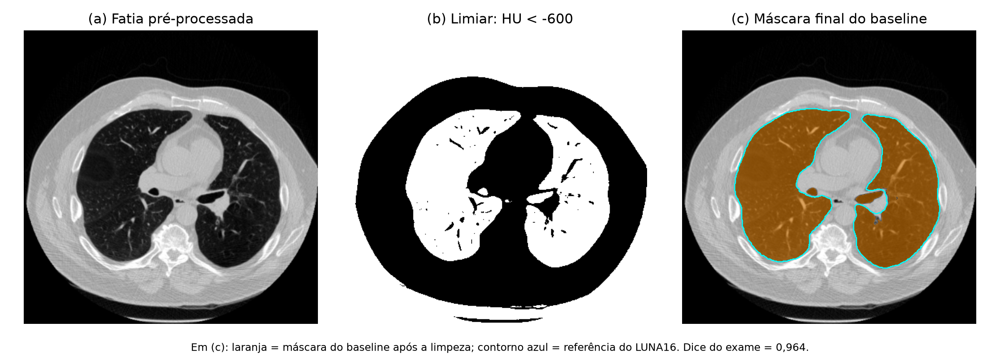

# Segmentação automática do parênquima pulmonar em TCs do LUNA16: comparação entre métodos clássicos e U-Net

**Modalidade:** Resumo Expandido

Érica Souza dos Santos; Amabilly Riva Dutra; Roger Caldeira de Oliveira; Herbe Fragoso; Rafael Cassiano Manchini; Ruan Matheus de Souza

---

## 1 INTRODUÇÃO

A segmentação do parênquima pulmonar em tomografias computadorizadas (TCs) é uma etapa relevante para a identificação de alterações e nódulos, pois delimita a região de interesse e reduz a interferência de estruturas externas. A literatura aborda técnicas como limiarização, crescimento de regiões e operações morfológicas [2], além de redes neurais convolucionais como a U-Net [3]. A escolha do tema baseia-se na necessidade de obter uma segmentação prévia confiável dos exames. Nesse contexto, investiga-se, no conjunto LUNA16, o quanto métodos clássicos baseados na intensidade dos voxels, de menor complexidade computacional e mais fáceis de interpretar, delimitam adequadamente os pulmões em comparação a uma U-Net 2D treinada, mesmo com variações anatômicas e de aquisição. A hipótese é que o parênquima, por ser aerado, ocupa a faixa de baixa densidade da escala Hounsfield (HU) e, por isso, pode ser separado dos demais tecidos por limiarização, atingindo boa concordância com as máscaras de referência, e que a U-Net, por aprender a forma do pulmão, supera os métodos clássicos.

O objetivo é desenvolver e comparar três métodos automáticos de segmentação pulmonar: (i) limiarização a −600 HU com morfologia matemática (baseline), (ii) crescimento de regiões (*region growing*) com sementes automáticas e (iii) U-Net 2D. A qualidade é medida pelo Dice e pelo IoU entre a máscara predita e a máscara de referência, com intervalos de confiança de 95% por *bootstrap*. Diferentemente da acurácia, essas métricas não são inflacionadas pela grande quantidade de voxels externos aos pulmões, o que permite uma análise adequada da região segmentada. A meta estabelecida é Dice médio ≥ 0,85.

## 2 REFERENCIAL TEÓRICO

O número de casos de câncer de pulmão diagnosticados tardiamente é alarmante, o que torna cada vez mais necessária a detecção automática de nódulos pulmonares em TCs, área ligada à *Computer-Aided Diagnosis* (CAD). Nesse contexto, a segmentação do parênquima pulmonar é a base para a detecção de nódulos, pois determina a região de busca e reduz a interferência de estruturas não relevantes, como costelas, mediastino e vasos maiores. Datasets como o LUNA16 fornecem uma estrutura de avaliação objetiva para algoritmos de detecção automática de nódulos [4]. O conjunto reúne 888 exames de TC da base LIDC-IDRI, anotados por quatro radiologistas experientes em um processo de duas fases [1], e disponibiliza máscaras de referência do parênquima pulmonar.

Abordagens clássicas combinam limiarização por unidades Hounsfield (HU) com morfologia matemática, pois dificilmente se obtêm bons resultados apenas com limiarização. Koyuncu propôs um *framework* em cascata para segmentação do parênquima em TCs axiais, combinando análise de histograma, operações morfológicas, *mean shift* e crescimento de região [2]. Como alternativa supervisionada, a U-Net [3] é uma rede convolucional do tipo codificador-decodificador com conexões de atalho, amplamente usada em segmentação biomédica.

## 3 METODOLOGIA

Trata-se de uma pesquisa aplicada, de natureza quantitativa, que compara três métodos automáticos de segmentação do parênquima pulmonar em TCs.

**Base de dados:** foi utilizado o LUNA16 (espessura de corte ≤ 3 mm, curadoria dos organizadores), em duas fases. Na primeira, 177 exames (subsets 0 e 1), todos aprovados nos critérios do grupo (máscara de referência presente e não vazia e espaçamento entre fatias ≤ 2,5 mm), foram divididos por paciente, com semente fixa (42), em treino (70%, 124 exames), validação (15%, 27) e teste (15%, 26); esse teste foi usado para desenvolver os métodos e corrigir erros. Na segunda fase, esses 177 exames foram separados e os 710 restantes (excluído um com geometria divergente entre imagem e máscara) foram divididos da mesma forma em treino (497), validação (106) e teste (107). O teste de 107 exames, que não participou de nenhuma decisão de desenvolvimento, é o conjunto oficial de comparação. A divisão é sempre por paciente, para evitar vazamento de dados entre os conjuntos.

**Pré-processamento:** as imagens foram carregadas com SimpleITK, preservando os metadados de espaçamento. Em seguida, valores de preenchimento (≤ −2047 HU) foram convertidos em ar (−1000 HU), a escala HU foi limitada a [−1000, 400], aplicou-se filtro gaussiano 3D (σ = 0,5 voxel) e os volumes foram reamostrados para espaçamento isotrópico de 1 mm.

**Métodos de segmentação:**
- *Baseline:* limiar HU < −600, remoção do ar de fundo fatia a fatia, retenção dos dois maiores componentes conexos 3D (os dois pulmões), preenchimento de buracos e abertura morfológica (erosão seguida de dilatação) com elemento esférico de raio 1 voxel.
- *Region growing:* sementes automáticas (limiar auxiliar de −320 HU para localizar candidatos e, em cada componente, o ponto mais interior pela transformada de distância entre os voxels abaixo de −750 HU) e crescimento por tolerância de intensidade de ±200 HU, com domínio restrito para impedir o vazamento pela traqueia, seguido de preenchimento de buracos.
- *U-Net 2D:* rede compacta (32 canais na base) com fatias axiais redimensionadas para 128×128, treinada com função de perda BCE + Dice (otimizador Adam, taxa de aprendizado 1e-3, lote de 16), 25 épocas, usando os 497 exames de treino da segunda fase, com duas sementes de treino (42 e 123). Na saída, são mantidos apenas os componentes com pelo menos 15% do volume do maior, para descartar o ar da mesa do tomógrafo.

**Avaliação:** o Dice, 2|A ∩ B| / (|A| + |B|), e o IoU, |A ∩ B| / |A ∪ B|, são calculados por exame, em 3D, entre a máscara predita (A) e a máscara de referência do LUNA16 (B), nos 107 exames de teste, com IC95% por *bootstrap* (10.000 reamostras). As hipóteses foram testadas com o teste de Wilcoxon unilateral pareado por exame, com correção de Holm para comparações múltiplas (α = 0,05).

## 4 RESULTADOS E DISCUSSÃO

Nos 107 exames de teste, o baseline obteve Dice médio de 0,949 (IC95% [0,934; 0,960]) e IoU médio de 0,910 (IC95% [0,889; 0,925]). O *region growing* obteve Dice médio de 0,935 (IC95% [0,920; 0,948]) e IoU de 0,886 (IC95% [0,865; 0,903]), e a U-Net, Dice médio de 0,984 (IC95% [0,983; 0,985]) e IoU de 0,968 (IC95% [0,966; 0,970]). Os três métodos ficaram, em média, acima da meta de 0,85 (p < 0,001). A U-Net superou o baseline (+0,035 de Dice, IC95% [0,024; 0,050]) e o *region growing* (+0,048) em todos os 107 exames (p < 0,001). Treinada com duas sementes, ela obteve 0,9841 e 0,9834 nos 99 exames em comum, uma variação de apenas ±0,0004. As mesmas conclusões já haviam aparecido no teste de 26 exames da primeira fase.

Ao contrário do esperado, o *region growing* foi pior que o baseline (−0,014 de Dice, IC95% [−0,028; −0,0004]) e só o superou em 15 dos 107 exames. A perda é de sensibilidade (0,901 contra 0,934), com precisão maior (0,981 contra 0,968): partindo de uma semente no ar do pulmão, a banda de ±200 HU interrompe o crescimento antes do limite de −600 HU usado pelo baseline e deixa de fora o parênquima mais denso.

O desempenho elevado do baseline, que não aprende nada dos dados, indica que segmentar o pulmão é um problema de alto contraste em HU. A vantagem da U-Net está nos casos difíceis: ela nunca ficou abaixo de 0,955, enquanto o baseline teve 3 exames abaixo da meta (o pior, com Dice 0,381) e o *region growing*, 6. O erro típico dos métodos clássicos é a omissão de regiões densas encostadas na parede do tórax. No teste da primeira fase, a máscara do baseline deixou de fora 13 dos 43 nódulos anotados (8 dos 9 colados na pleura), e a da U-Net, 3 (McNemar, p = 0,006). Isso importa porque um nódulo fora da máscara não chega à etapa de detecção. O Dice da U-Net está na faixa de 0,97 a 0,98 relatada para U-Net em segmentação de pulmão [5].

**Figura 1** – Etapas do baseline em uma fatia axial de um exame típico do teste da primeira fase (Dice 0,964): (a) fatia pré-processada; (b) limiar HU < −600; (c) máscara final após a limpeza (laranja), com o contorno da referência do LUNA16 (azul). Os brônquios principais entram na máscara do baseline, mas não na referência.
Fonte: os autores.

Como limitações, todos os exames vêm de uma única base (LIDC-IDRI), a análise de nódulos foi feita no teste menor da primeira fase e as máscaras de referência do LUNA16 foram geradas por algoritmo automático, e não por segmentação manual; concordar com elas não equivale a concordar com a anatomia real. Em alguns exames, a máscara de referência marca gás do abdome como pulmão, e a U-Net, que o exclui, é penalizada no Dice.

## 5 CONSIDERAÇÕES FINAIS

Este trabalho comparou três métodos de segmentação do parênquima pulmonar em TCs do LUNA16, em 107 exames de teste que não participaram do desenvolvimento. O baseline clássico atingiu Dice de 0,949, o *region growing*, de 0,935, e a U-Net, de 0,984, todos acima da meta de Dice ≥ 0,85. Métodos de baixa complexidade computacional já produzem segmentações consistentes na média, mas falham nos casos difíceis e na borda do pulmão, justamente onde ficam os nódulos colados na pleura. A U-Net corrige esses casos, o que a torna a escolha indicada como base para a detecção de nódulos.

Como trabalhos futuros, pretende-se repetir a análise de nódulos no teste de 107 exames, treinar uma terceira semente da U-Net, validar os métodos em exames de outras instituições e integrar os três modelos à interface web de demonstração, que já consome a API desenvolvida pelo grupo, permitindo sua utilização nas etapas posteriores de detecção de nódulos pulmonares.

## REFERÊNCIAS

[1] ARMATO III, S. G. et al. The Lung Image Database Consortium (LIDC) and Image Database Resource Initiative (IDRI): a completed reference database of lung nodules on CT scans. *Medical Physics*, v. 38, n. 2, p. 915–931, 2011. DOI: 10.1118/1.3528204.

[2] KOYUNCU, H. Lupsix: a cascade framework for lung parenchyma segmentation in axial CT images. *International Journal of Intelligent Systems and Applications in Engineering*, v. 6, n. 4, p. 322–328, 2018. DOI: 10.18201/ijisae.2018448460.

[3] RONNEBERGER, O.; FISCHER, P.; BROX, T. U-Net: convolutional networks for biomedical image segmentation. In: *Medical Image Computing and Computer-Assisted Intervention – MICCAI 2015*. Cham: Springer, 2015. p. 234–241. DOI: 10.1007/978-3-319-24574-4_28.

[4] SETIO, A. A. A. et al. Validation, comparison, and combination of algorithms for automatic detection of pulmonary nodules in computed tomography images: the LUNA16 challenge. *Medical Image Analysis*, v. 42, p. 1–13, 2017. DOI: 10.1016/j.media.2017.06.015.

[5] HOFMANNINGER, J. et al. Automatic lung segmentation in routine imaging is primarily a data diversity problem, not a methodology problem. *European Radiology Experimental*, v. 4, art. 50, 2020. DOI: 10.1186/s41747-020-00173-2.
